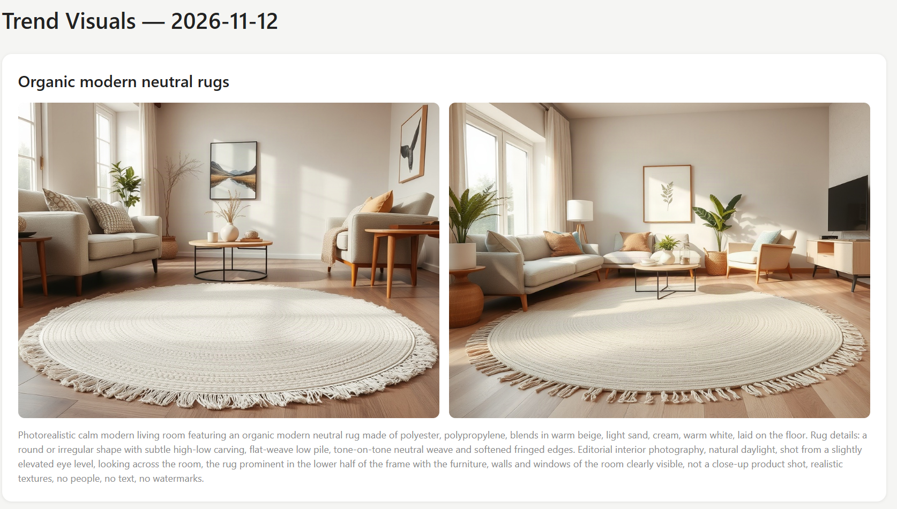
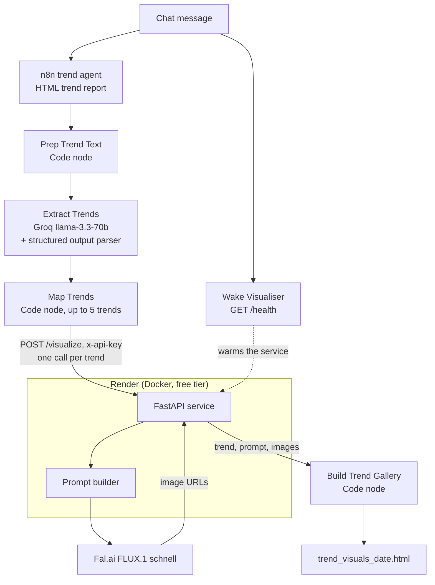
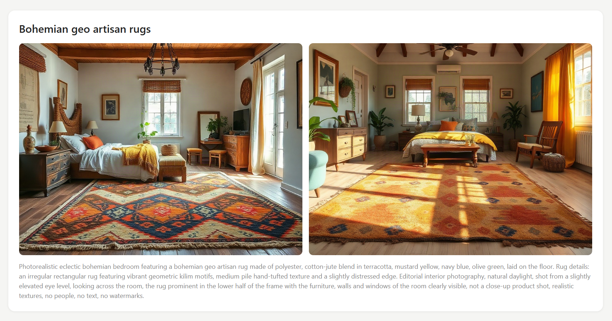
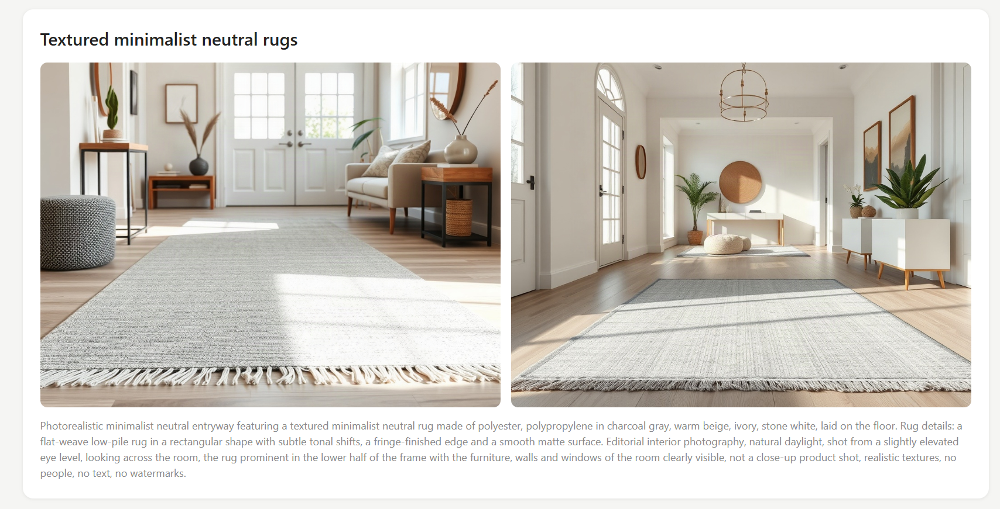

# Trend Visualizer

Turns rug trends found by an n8n AI agent into photorealistic room images, so merchandisers see a
trend instead of reading about it.



## Why

Trend dashboards describe trends in words, such as "organic modern neutral rugs rising". A
merchandiser or creative team still has to picture what that looks like in a customer's room. This
service closes that gap: every trend the agent reports becomes a card of room images in an HTML
gallery, produced in the same workflow run.

Built as an extension to the Wayfair AI Agent Engineering externship (Extern).

## Architecture



A chat message starts the existing n8n trend agent, which writes an HTML trend report. The trend
branch strips that report to text, and an LLM step on Groq extracts up to 5 visual trends as
structured JSON (name, materials, colors, room style, rug look). A Code node maps each trend to a
request body. The FastAPI service on Render builds an image prompt, calls Fal.ai and returns image
URLs. A final Code node assembles one self-contained HTML gallery with a card per trend, which you
download from the workflow like the trend report.

## API

| Endpoint | Method | Auth | Returns |
| --- | --- | --- | --- |
| `/health` | GET | none | `{"status": "ok"}` |
| `/visualize` | POST | `x-api-key` header | trend name, prompt used, image URLs |

Request body: `name` (required), `materials[]`, `colors[]`, `style`, `look` (optional, at most 300
characters), `num_images` (1 to 3, default 2).

```json
{
  "name": "Organic modern neutral rugs",
  "materials": ["wool", "polyester"],
  "colors": ["warm beige", "cream", "soft sand"],
  "style": "calm minimalist living room",
  "look": "a round, irregular shape with subtle high-low carving in tone-on-tone neutrals",
  "num_images": 2
}
```

Response:

```json
{
  "trend": "Organic modern neutral rugs",
  "prompt": "Photorealistic calm minimalist living room featuring an organic modern neutral rug made of wool, polyester in warm beige, cream, soft sand, laid on the floor. Rug details: a round, irregular shape with subtle high-low carving in tone-on-tone neutrals. Editorial interior photography, natural daylight, ...",
  "images": ["https://...", "https://..."]
}
```

| Status | Meaning |
| --- | --- |
| `401` | `x-api-key` missing or wrong, or `SERVICE_API_KEY` not set on the server |
| `422` | invalid body (missing `name`, `num_images` outside 1 to 3, `look` too long) |
| `502` | Fal.ai failed, timed out (60 s) or returned no image URLs |

## Engineering decisions

- **API-key auth fails closed:** if `SERVICE_API_KEY` is unset, every request gets a 401, and keys are compared with `secrets.compare_digest`.
- **Secrets only in env vars and n8n credentials:** `FAL_KEY` lives on Render only, the service key lives in an n8n Header Auth credential, and a build script rejects any credential or key-like string in the exported n8n snippet.
- **`num_images` capped at 3:** a single request can't run up the Fal bill.
- **Fal errors map to 502:** the client gets a generic "Image generation failed"; the error is logged server-side and upstream details are never returned.
- **Prompt builder with a fixed style suffix:** camera angle, lighting and "no people, no text" are fixed in every prompt, tuned in a Phase 0 spike that compared FLUX.1 schnell (about $0.003 per image) with FLUX 2 Pro (about $0.03).
- **LLM structured extraction:** the trend agent only outputs an HTML report, so an LLM chain with a structured output parser turns it into typed trend fields.
- **Groq for extraction:** Gemini 2.5 Flash returned 404 (retired for new API keys) and Gemini 3.8 Flash failed with "fetch failed" from this n8n version, so the chain uses Groq `llama-3.3-70b-versatile`.
- **Render free tier with a wake-up call:** the service sleeps after 15 minutes idle, so the workflow pings `/health` when the chat message arrives and the service is warm by the time trends are ready; `/visualize` calls use a 120 s timeout and 2 retries.
- **Mocked tests:** pytest mocks the Fal client, and the n8n Code node scripts are tested with Node's built-in runner, so no test spends money.

## Run locally

Requires Python 3.11+ (PowerShell commands, run from the repo root).

```powershell
python -m venv .venv
.\.venv\Scripts\Activate.ps1
pip install -r requirements.txt
Copy-Item .env.example .env          # then set FAL_KEY and SERVICE_API_KEY in .env
uvicorn app.main:app --reload        # http://127.0.0.1:8000, docs at /docs
```

Tests (no network calls):

```powershell
pytest
node --test "n8n/tests/*.test.js"
```

Docker:

```powershell
docker build -t trend-visualiser .
docker run --rm -p 8000:8000 --env-file .env trend-visualiser
Invoke-RestMethod http://127.0.0.1:8000/health
```

A real `/visualize` call costs money (about $0.006 for 2 images):

```powershell
$body = @{ name = "Organic modern neutral rugs"; materials = @("wool"); colors = @("warm beige", "cream"); style = "calm minimalist living room" } | ConvertTo-Json
Invoke-RestMethod -Method Post -Uri http://127.0.0.1:8000/visualize -ContentType "application/json" -Headers @{ "x-api-key" = "<your SERVICE_API_KEY>" } -Body $body
```

## Deploy

The service runs as a Docker web service on Render's free tier.

1. New → Web Service, connect this repo, Runtime `Docker`, Instance type `Free`.
2. Environment variables: `FAL_KEY` and `SERVICE_API_KEY`. Render sets `PORT`, which the
   Dockerfile uses.
3. Health check path: `/health`.

The free tier spins down after 15 minutes idle; the first request after that takes about a minute.

## n8n

Node-by-node setup, the paste-ready branch snippet and a test checklist are in
[n8n/SETUP.md](n8n/SETUP.md).

## Results

| Metric | Value |
| --- | --- |
| `/visualize` latency, 2 images (warm service, end to end against Render) | 2.0 s |
| Trends that passed visual QA | 3 / 3 (the live run produced 3 trends) |
| Total Fal.ai spend | $0.04 of a $15 budget (FLUX.1 schnell only) |
| Tests | 19 pytest, 19 Node, all passing |

### More examples





## Limitations and next steps

- **Fal image URLs aren't permanent.** The gallery loads images from Fal's CDN, so older galleries
  can lose their images. Copying images to own storage would fix this.
- **Cold starts.** On the free tier the first call after 15 minutes idle takes about a minute; the
  wake-up ping hides this in the workflow but not for direct calls.
- **No persistence.** Nothing is stored; every run regenerates its images.
- **Next step: a VLM-judge loop.** A vision model scores each image against the trend brief (rug
  visible, materials and colors match, no artifacts) and regenerates low scorers before the gallery
  is built.
