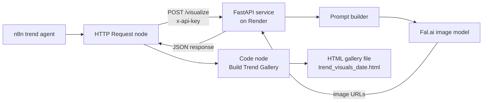

# Trend Visualizer — MVP PRD

Sep 24, 2026 · Devarsh Prajapati

## Overview

Trend Visualizer turns rug trends found by the n8n trend agent into photorealistic room images, collected in an HTML gallery file that the workflow generates next to its trend report. It is a small FastAPI service that the n8n workflow calls, built as an extension to the Wayfair externship and demoed in the final presentation.

**Problem:** the dashboard describes trends in words, like "vintage-wash jute rugs rising." A merchandiser or creative team still has to imagine what that looks like in a customer's room. Visualizing trends automatically closes that gap and mirrors the work of Wayfair's Visual AI Technology team.

## Goals and non-goals

The MVP proves one thing: a trend agent's output can automatically become a room visual in the gallery.

**Goals**

- Generate 2–3 room images per trend from structured trend data
- Run automatically inside the existing n8n trend workflow
- Show images in an HTML gallery file (`trend_visuals_<date>.html`) built by an n8n Code node
- Deliver a 60–90 second demo for the final group presentation
- Show engineering skills relevant to Visual AI: FastAPI, Docker, API auth, generative model APIs

**Non-goals**

- No custom frontend (the generated HTML gallery is the UI)
- No Kubernetes, database or model fine-tuning
- No real Wayfair product images as model input
- No production-grade scale or cost optimization

## Users and core use case

The primary user is a member of Wayfair's Rugs team reading the Market Intelligence Dashboard. The secondary audience is the mentor and cohort at the final presentation.

**Core use case:** the trend agent flags a rising trend. Within the same workflow run, the gallery gains a card showing that trend as 2–3 room images, so the reader sees the trend instead of imagining it.

## MVP scope

The MVP is five features, about 15–25 hours and 200–300 lines of Python.

| Feature | Priority | Est. effort |
| --- | --- | --- |
| Prompt builder: trend data to a consistent image prompt | Must | 2–3 hrs |
| FastAPI service with `/visualize` and `/health`, API key auth | Must | 4–6 hrs |
| Docker image, deployed on Render (free tier) | Must | 1–2 hrs |
| n8n HTTP Request node + "Build Trend Gallery" Code node (HTML gallery) | Must | 3–5 hrs |
| Demo clip and 2–3 final deck slides | Must | 3–4 hrs |
| README and basic pytest tests (Fal call mocked) | Should | 2 hrs |
| React gallery page per trend | Stretch | 4–6 hrs |

The stretch item is cut first if any required project falls behind.

## Architecture and data flow

n8n orchestrates; a small containerized Python service does the image work. Before the HTTP call, an n8n Basic LLM Chain on Groq (`llama-3.3-70b-versatile`) extracts up to 5 visual trends from the trend report and a Code node maps them to the request body.



The Code node builds one self-contained HTML page (inline CSS, one card per trend) and returns it as a downloadable `text/html` binary, the same way the workflow's existing HTML report is downloaded. The page loads images straight from their Fal URLs. Secrets (`FAL_KEY`, `SERVICE_API_KEY`) live in Render environment variables and an n8n credential, never in code or the workflow JSON.

The service runs as a Docker web service on Render's free tier, which spins down after 15 minutes idle; the first request after that takes about a minute while it cold-starts.

**Repo layout:** `app/main.py` (endpoints), `app/prompts.py` (prompt builder), `app/generator.py` (Fal call), plus `Dockerfile`, `requirements.txt`, `.env.example` and `README.md`.

## API spec

Two endpoints. `/visualize` requires an `x-api-key` header; a wrong or missing key returns 401.

| Endpoint | Method | Auth | Returns |
| --- | --- | --- | --- |
| `/health` | GET | None | `{"status": "ok"}` |
| `/visualize` | POST | `x-api-key` header | Trend name, prompt used, image URLs |

**Request body for `/visualize`:**

```json
{
  "name": "Vintage-wash jute",
  "materials": ["jute"],
  "colors": ["warm neutrals", "faded terracotta"],
  "style": "boho living room",
  "num_images": 2
}
```

**Response:**

```json
{
  "trend": "Vintage-wash jute",
  "prompt": "Editorial interior photo of a boho living room...",
  "images": ["https://...", "https://..."]
}
```

**Errors:** 401 for a bad key, 422 for an invalid body (FastAPI default), 502 if the image API fails or times out. `num_images` is capped at 3 to control cost.

## Success criteria

The MVP is done when all of these are true:

- [ ] Running the n8n trend workflow produces an HTML gallery of room images with no manual steps
- [ ] At least 4 of 5 real trends produce images good enough to show a Wayfair senior
- [ ] `/visualize` responds in under 30 seconds for 2 images
- [ ] The service rejects requests without a valid API key
- [ ] No secrets in the repo or the exported n8n workflow
- [ ] Demo clip is 90 seconds or less and plays without a live connection
- [ ] Total image API spend stays under $15

## Milestones

A working end-to-end version lands before the Oct 29 mentor meeting; features freeze Nov 9. Time is capped at 3–4 hours a week, and required projects always come first.

| Dates | Milestone | Done when |
| --- | --- | --- |
| Sep 24 – Sep 30 | Setup + spike | Repo created; a prompt template reliably gives good room images |
| Oct 1 – Oct 14 | Service built | `docker run` returns image URLs for any posted trend |
| Oct 15 – Oct 28 | Deployed + connected | n8n trend workflow produces the HTML gallery automatically |
| Oct 29 | Mentor preview | Idea mentioned to Gautham if there's an opening; feedback noted |
| Oct 29 – Nov 8 | Polish | README, tests, mentor feedback folded in |
| Nov 9 – Nov 16 | Freeze + present | Demo clip recorded; 2–3 slides added to the final deck |

## Risks and mitigations

The biggest risk is the extension eating time the required projects need.

| Risk | Mitigation |
| --- | --- |
| Extension crowds out Projects 2–5 | 3–4 hr weekly cap; pause the extension any week a required project slips |
| Image quality is inconsistent | Validate in the spike before building; fixed style suffix in every prompt |
| Agent output is too messy to map into fields | Groq LLM extraction step with a structured output parser, then a Code node cleanup before the HTTP call |
| Live demo fails on Zoom | Present a pre-recorded clip, not a live call |
| API costs or leaked keys | API key auth on the service, `num_images` cap, secrets only in env vars |
| n8n can't reach the service | Deploy early on Render and test the call from n8n in week 3 |
| Render free-tier cold start (~1 min after 15 min idle) breaks the 30-second target | n8n pings `GET /health` at the start of the run so the service is warm; 120-second timeout on the `/visualize` call |

## Open questions

- [ ] Which Fal.ai model gives the best quality-to-cost for rooms? Decide during the spike.
- [ ] What fields does the Project 2 trend agent actually output? Shapes the request body.
- [ ] Is n8n self-hosted or cloud for this externship? Affects how it reaches Render.
- [ ] Does Extern allow extra work in the final deck, and how many minutes per presenter?
- [ ] What team is Gautham on? Shapes how the extension is framed.